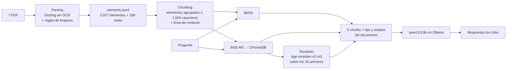
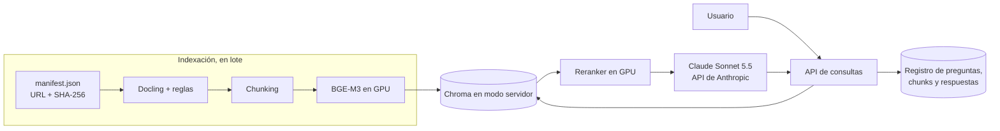

# RAG sobre datos personales e inteligencia artificial en México

Mini-proyecto RAG · Procesamiento de Lenguaje Natural

Cada sección (separada por `---`) es una diapositiva. Todo el código está en [`main/parser.ipynb`](../main/parser.ipynb) y [`main/rag.ipynb`](../main/rag.ipynb); los fragmentos de aquí están resumidos.

---

## 1. Caso de uso

Un asistente de consulta para una organización en México que trata datos personales y usa o desarrolla sistemas de IA. Responde qué dice cada documento, cita de dónde sale y **distingue una ley vigente de una guía no vinculante o de una propuesta legislativa**.

| Documento | Tipo | Estatus | Páginas |
|---|---|---|---:|
| LFPDPPP (datos personales en posesión de particulares) | Ley | Vigente; 2025 | 24 |
| LGPDPPSO (datos personales en el sector público) | Ley | Vigente; 2025 | 37 |
| Reglamento de la LFPDPPP | Reglamento | Vigente; redactado para la ley de 2010 | 36 |
| Recomendaciones del INAI sobre datos personales e IA | Guía | No vinculante; 2024, anterior a la ley de 2025 | 48 |
| Evaluación de preparación en IA de la UNESCO para México | Informe | No vinculante; 2024 | 74 |
| Principios de Chapultepec | Declaración | No vinculante; 2026 | 2 |
| Iniciativa de Ley General para el Uso y Control de la IA | Iniciativa | Propuesta; no es ley | 42 |
| **Total** | | | **263** |

---

## 2. Por qué este corpus

- **Tema común con traslape real.** Los derechos ARCO aparecen en las dos leyes y el reglamento, y el consentimiento en seis de los siete documentos: el retriever tiene pasajes plausibles pero incorrectos entre los cuales elegir.
- **Confusión difícil.** La LFPDPPP y la LGPDPPSO comparten vocabulario y numeración, pero una regula a empresas y la otra al gobierno.
- **Autoridad distinta.** La mezcla de ley, guía y propuesta permite evaluar si el sistema presenta como vigente algo que no lo es. En México no hay una ley general de IA: solo una iniciativa.
- **Retos de parsing reales.** Tablas de cuatro columnas, notas al pie, encabezados repetidos y un PDF escaneado con OCR ruidoso (la iniciativa).

---

## 3. Arquitectura



| Etapa | Elección | Alternativas descartadas |
|---|---|---|
| Parsing | Docling sin OCR | PyMuPDF, pdfplumber, Docling con OCR |
| Chunking | Elementos agrupados, 1,500 caracteres, sin traslape, con línea de contexto | Tamaño fijo, división recursiva, chunking semántico, chunker de Docling |
| Embeddings | BGE-M3 (local) | multilingual-e5-large, Qwen3-Embedding-0.6B, text-embedding-3 de OpenAI |
| Base vectorial | ChromaDB | Qdrant, FAISS, pgvector |
| Recuperación | BM25, embeddings y embeddings + reranker | Búsqueda híbrida, reescritura de la pregunta (trabajo futuro) |
| LLM | qwen3.5:9b local en Ollama | Claude Opus 5.5, Claude Sonnet 5.5, GPT, gemma4:12b, gpt-oss:20b |
| Evaluación | Precision@k y Recall@k anotados a mano; RAGAS con juez local | |

Todo corre en una computadora: GPU RTX 5060 Ti de 16 GB (LLM) y CPU (Docling, embeddings y reranker).

---

## 4. Parsing: comparación de parsers

Se compararon tres parsers, con su configuración por defecto, en tres páginas que reúnen los retos del corpus:

| Página | Qué pone a prueba |
|---|---|
| UNESCO p. 45 | Tabla con cifras y una celda de dos líneas, notas al pie, marcadores de nota en superíndice |
| INAI p. 35 | Tabla de cuatro columnas con celdas largas y guiones de fin de línea |
| Iniciativa p. 28 | Página escaneada: el texto del PDF viene de un OCR previo (`11.` en lugar de `II.`) |

**Decisión: Docling con el OCR desactivado** (`do_ocr=False`).

- **UNESCO:** fue el único que dejó cada actividad de la tabla en la misma fila que sus cifras y separó el marcador de nota del año (`2023 160` en lugar de `2023160`). También detecta títulos, encabezados y pies de página.
- **Iniciativa:** sin OCR conserva todo el texto del PDF. Con OCR, Docling volvió ilegibles las fracciones III y IV del artículo 66.
- **Descartados:** pdfplumber intercala las columnas de la tabla del INAI línea por línea, y las oraciones ya no se pueden recuperar. PyMuPDF extrae bien el texto, pero habría que escribir a mano las reglas que Docling ya trae (títulos, encabezados, notas).
- **Costo:** 0.7 a 2 s por página en CPU y unos 500 MB de modelos, contra menos de 0.3 s de PyMuPDF.

```python
converter = DocumentConverter(
    format_options={InputFormat.PDF: PdfFormatOption(pipeline_options=PdfPipelineOptions(do_ocr=False))}
)
```

---

## 5. Parsing: retos y soluciones

| Reto | Solución | Por qué |
|---|---|---|
| Encabezados y pies repetidos que Docling no marcó (el lema «2025, AÑO DE LA MUJER INDÍGENA», «CÁMARA DE DIPUTADOS…») | Tres reglas: capa de encabezados de Docling, texto repetido en ≥ 30 % de las páginas, y similitud ≥ 85 % en las franjas superior e inferior. Se quitan 697 de 4,516 elementos | Varios estaban marcados como títulos, así que la sección vigente de casi todo era el lema del año, e inflaban palabras en BM25. El umbral de 20 % ya quitaba texto real del INAI |
| Tablas: relleno, columnas de casillas vacías y cabecera perdida al dividir | Una línea por fila con el nombre de cada columna: `ACTIVIDADES: …; 2021: 30,691` | Cada fila se entiende sola aunque la tabla se divida en varios chunks. 69,003 caracteres en Markdown bajan a 30,987 |
| Notas al pie en medio del texto | Se separan del flujo (288 notas) y se indexan aparte | Cortaban párrafos a la mitad; quitarlas perdería definiciones como la de IA |
| 13 líneas que Docling omitió (6 notas del INAI) | Se comparan las líneas de PyMuPDF con las cajas de Docling y se recuperan las no cubiertas | La nota 76 trae la definición de cómputo en la nube. La comprobación sirve para cualquier documento nuevo |
| Etiquetas equivocadas de Docling (11) | Una nota debe empezar con su número; «NN Disponible en:» es nota | Regresa «DECRETA:» de la LGPDPPSO al texto y recupera 10 notas del INAI |
| Índices | Se quitan explícitamente (4) | Repetirían cada título y BM25 los pondría arriba sin contener respuestas |

```python
def removal_reasons(doc_rows):
    keys = doc_rows["text"].map(normalize)  # sin dígitos ni espacios: «1 de 24» = «2 de 24»
    pages_per_key = doc_rows.groupby(keys)["page"].nunique()
    repeated = set(pages_per_key[pages_per_key >= max(3, 0.30 * n_pages)].index) - {""}
    ...
        if row["layer"] == "furniture":       reasons.append("furniture")
        elif key in repeated:                 reasons.append("repetición")
        elif key and in_strip and similar(key): reasons.append("similitud")
```

Nada se borra: la columna `removed` guarda la regla, para poder auditarla.

**Limitaciones aceptadas:** números romanos mal leídos en la iniciativa (`111` por `III`), números de nota dentro del texto, texto dentro de imágenes y 77 notas del INAI que solo son un enlace.

---

## 6. Chunking: estrategia

**Decisión: agrupar elementos consecutivos** hasta un límite de tamaño. Un título de sección empieza un chunk nuevo, y en las leyes, el reglamento y la iniciativa también cada «Artículo N». Los elementos no se cortan.

| A unos 1,000 caracteres por chunk | Tamaño fijo con traslape de 150 | Elementos agrupados |
|---|---:|---:|
| Chunks que empiezan a mitad de un párrafo | 802 de 813 | 0 |
| Chunks legales que mezclan dos o más artículos | 174 | 0 |

- **Por qué:** en una ley, el artículo es la unidad de respuesta. Un chunk que mezcla dos artículos se recupera por uno y cita mal el otro.
- **Descartados:** tamaño fijo (corta oraciones y artículos), división recursiva (sigue mezclando artículos), chunking semántico (necesita embeddings antes de dividir y es difícil de reproducir, cuando los documentos ya marcan su estructura) y el chunker de Docling (ignoraría la limpieza del parsing).

```python
def starts_chunk(element, doc_type):
    if element["label"] in HEADING_LABELS:
        return True
    return doc_type in ARTICLE_TYPES and bool(ARTICLE_START.match(element["text"]))  # «Artículo N»


def pack_elements(doc_flow, doc_type, max_chars):
    groups, current = [], []
    for element in doc_flow.to_dict("records"):
        size = sum(len(item["text"]) for item in current)
        has_body = any(item["label"] not in HEADING_LABELS for item in current)
        if current and has_body and (starts_chunk(element, doc_type) or size + len(element["text"]) > max_chars):
            groups.append(current)
            current = []
        current.append(element)
    ...
```

---

## 7. Chunking: tamaño, contexto y casos especiales

**1,500 caracteres (unos 375 tokens), sin traslape.**

| Límite | Chunks | Mediana | Chunks legales que continúan un artículo |
|---:|---:|---:|---:|
| 1,000 | 1,080 | 651 | 184 |
| **1,500** | **865** | **702** | **87** |
| 2,000 | 768 | 665 | 46 |

- Parte la mitad de artículos que 1,000 y cabe con margen en modelos de 512 tokens. Por encima de 1,000 la mediana casi no cambia, porque la mayoría de los artículos son cortos.
- **Sin traslape** porque los elementos nunca se cortan: no se pierde ninguna oración entre chunks.

**Línea de contexto al inicio de cada chunk:**

```
Ley Federal de Protección de Datos Personales en Posesión de los Particulares (LFPDPPP) | Disposiciones Generales | Artículo 2 (continuación)
```

- **Por qué:** 137 de los 144 números de artículo se repiten en dos o más textos legales; solo 84 de 865 chunks nombran su documento; y 82 de los 87 chunks que continúan un artículo no dicen cuál es.
- Se indexa y se pasa al LLM `full_text` (contexto + texto). Se descartó que un LLM escribiera el contexto (865 llamadas, no reproducible).

**Casos especiales:** las notas al pie con texto se indexan agrupadas por página (204 notas en 49 chunks; las 84 que solo son un enlace no); las 11 tablas más largas que el límite se dividen entre filas; los chunks pequeños se quedan, porque unirlos mezclaría artículos.

**Resultado:** 927 chunks (878 de texto y 49 de notas), 191 tokens de mediana y 545 de máximo.

---

## 8. Consultas de evaluación

**Decisión: preguntas realistas**, como las haría un responsable de cumplimiento o un desarrollador, no dirigidas a los retos del parsing. Representan el uso real; la consecuencia es que ninguna toca las tablas del INAI ni el texto escaneado.

| id | Pregunta | Tipo |
|---|---|---|
| q01 | ¿La obligación de guardar confidencialidad es igual para empresas que para dependencias de gobierno? | Respondible |
| q02 | ¿En qué artículo de la LFPDPPP está el deber de confidencialidad? | Respondible |
| q03 | Si contrato un servicio en la nube, ¿el proveedor tiene que guardar confidencialidad de los datos? | Respondible |
| q04 | ¿Puedo oponerme a que un banco decida si me da un crédito usando solo un algoritmo? | Respondible |
| q05 | Mi app de salud guarda el historial médico de los usuarios, ¿qué tipo de consentimiento necesito? | Respondible |
| q06 | ¿Qué le recomienda la UNESCO a México para regular la inteligencia artificial? | Respondible |
| q07 | ¿Qué dicen los Principios de Chapultepec sobre quién responde por una decisión tomada con IA? | Respondible |
| q08 | Si se aprueba la iniciativa de ley de IA del Senado, ¿qué castigo tendría usar IA para suplantar la identidad de alguien? | Respondible |
| q09 | ¿Qué multas establece la ley de inteligencia artificial que está vigente en México? | **Trampa:** premisa falsa, no hay ley de IA vigente |
| q10 | ¿Cómo presento una queja ante el INAI si una empresa no responde mi solicitud para borrar mis datos? | **Trampa:** premisa desactualizada, las funciones del INAI pasaron a la Secretaría Anticorrupción y Buen Gobierno |

Entre todas cubren los 7 documentos.

**Anotación con citas, no con identificadores de chunk.** Cada consulta guarda su respuesta ideal y las citas exactas que la responden; los chunks esperados son los que contienen alguna cita. Si el chunking cambia, la anotación sigue valiendo. Las trampas también tienen pasajes esperados (los que corrigen la premisa), así que entran en las métricas.

```json
{"id": "q04", "question": "¿Puedo oponerme a que un banco decida…?", "type": "respondible",
 "ideal_answer": "Sí. El artículo 26, fracción II, de la LFPDPPP…",
 "evidence": [{"doc_id": "lfpdppp", "page": 8, "quote": "Sus datos personales sean objeto de un tratamiento automatizado…"}]}
```

---

## 9. Embeddings: BGE-M3

**Decisión: BGE-M3** (`BAAI/bge-m3`), local con `sentence-transformers`.

- **Multilingüe:** entrenado para recuperación en más de 100 idiomas, incluido el español.
- **No corta ningún chunk:** lee hasta 8,192 tokens; el chunk más largo mide 545. Un modelo de 512 tokens cortaría 2.
- **Gratuito y local:** el corpus no sale de la computadora y los resultados se pueden reproducir.
- **Descartados:** multilingual-e5-large (límite de 512 tokens y prefijos obligatorios), Qwen3-Embedding-0.6B (más nuevo, con menos referencias) y text-embedding-3 de OpenAI (de pago y depende de un modelo alojado que puede retirarse).

```python
embedder = SentenceTransformer("BAAI/bge-m3")

def embed(texts):
    return embedder.encode(texts, batch_size=16, normalize_embeddings=True)  # 1,024 dimensiones
```

Los 927 vectores tardaron 354 s en CPU y se guardan en `data/embeddings/` para no recalcularlos.

---

## 10. Base vectorial: ChromaDB

**Decisión: ChromaDB**, con distancia coseno.

- **Sin servidor:** funciona dentro de Python y guarda la colección en disco. Para producción tiene un modo cliente-servidor.
- **Texto y metadatos junto al vector:** documento, tipo, páginas, sección y si el documento es vinculante, para filtrar por ellos.
- **Escala suficiente:** 927 chunks hoy y unos 66,000 con 500 documentos; cualquier opción los busca en milisegundos, así que pesó más la sencillez.
- **Descartados:** Qdrant (más funciones de producción, como búsqueda híbrida nativa, pero más configuración), FAISS (no guarda texto ni metadatos) y pgvector (requiere un servidor PostgreSQL).

```python
collection = chroma.create_collection("chunks", configuration={"hnsw": {"space": "cosine"}})
collection.add(
    ids=chunks["chunk_id"].tolist(),
    embeddings=chunk_vectors,
    documents=chunks["full_text"].tolist(),
    metadatas=[{"doc_id": ..., "kind": ..., "pages": ..., "heading": ..., "binding": ...} for chunk in ...],
)
```

---

## 11. Recuperación: tres estrategias

| Estrategia | Cómo funciona | Por qué |
|---|---|---|
| **BM25** | Palabras clave; minúsculas, sin acentos, sin quitar palabras vacías (BM25 ya les da poco peso) | Favorece términos exactos: siglas y números de artículo |
| **Embeddings** | BGE-M3 en ChromaDB | Favorece preguntas dichas con otras palabras que el documento |
| **Embeddings + reranker** | Un cross-encoder (bge-reranker-v2-m3) reordena los 30 primeros de los embeddings | Se agregó después del análisis de errores (siguiente diapositiva) |

```python
def search_bm25(question, k):
    scores = bm25.get_scores(tokenize(question))
    return [chunk_ids[i] for i in np.argsort(-scores)[:k]]


def search_embeddings(question, k):
    return collection.query(query_embeddings=embed([question]), n_results=k)["ids"][0]


reranker = CrossEncoder("BAAI/bge-reranker-v2-m3", max_length=1024)

def rerank(question):
    ranking = search_embeddings(question, len(chunk_ids))
    candidates = ranking[:30]
    scores = reranker.predict([(question, full_texts[chunk_id]) for chunk_id in candidates])
    return [candidates[i] for i in np.argsort(-scores)] + ranking[30:]
```

---

## 12. Por qué se agregó el reranker

Después del análisis de errores se propusieron siete mejoras; se eligió el reranker.

- **El chunk correcto estaba cerca, pero fuera de los 5 primeros.** Con embeddings, el artículo 26 de la LFPDPPP (q04) quedó en la posición 27 y la tabla de recomendaciones de la UNESCO (q06) en la 11. Un reranker solo reordena candidatos, así que sirve justo en ese caso.
- **Juzga si el pasaje responde, no solo si trata el mismo tema.** Los embeddings comparan dos vectores calculados por separado y premian los chunks del mismo tema (en q06, el prólogo y los agradecimientos). El cross-encoder lee la pregunta y el chunk juntos. Es más preciso, pero más lento y no se puede precalcular, así que solo se aplica a 30 candidatos.
- **Candidatos de los embeddings, no de BM25:** entre sus 30 primeros hay más chunks esperados (Recall@30 de 0.72 contra 0.53), y el reranker no puede subir un chunk que no está entre los candidatos.
- **Misma familia que BGE-M3**, multilingüe, local y gratuito. Se usa con 1,024 tokens, más que el chunk más largo junto con la pregunta.
- **Costo:** 2.3 GB de modelo y unos 13 s por consulta en CPU.

Las demás propuestas (búsqueda híbrida, reescribir la pregunta con el LLM, título corto en el índice, stemming en español) quedan como trabajo futuro.

---

## 13. Generación: LLM local

**Decisión: qwen3.5:9b en Ollama**, en la GPU local.

- **Gratuito y privado:** sin clave de API ni costo por consulta, y el corpus no sale de la computadora.
- **Español:** su página en Ollama declara soporte para 201 idiomas y dialectos.
- **Cabe con holgura:** 6.6 GB de los 16 GB de la GPU, unos 45 tokens por segundo.
- **Desventaja aceptada:** un modelo de 9B razona peor los matices legales que un modelo grande por API, y es menos confiable como juez de RAGAS.
- **Descartados:** Claude Opus 5.5, Claude Sonnet 5.5 y GPT (de pago, y el corpus sale de la computadora), gemma4:12b (más lento) y gpt-oss:20b (ocupa casi toda la GPU y se entrenó sobre todo en inglés).

**Detalles:** los 5 primeros chunks; temperatura 0 y sin modo de razonamiento, para respuestas reproducibles; contexto de 16,384 tokens (el de Ollama por defecto, 4,096, es justo para 5 chunks más las instrucciones).

```python
SYSTEM_PROMPT = """Eres un asistente sobre protección de datos personales e inteligencia artificial en México.
Responde en español usando solo los fragmentos proporcionados.
- Cita el documento y el artículo o la página de donde sale cada dato.
- Si los fragmentos no contienen la respuesta, dilo claramente y no inventes.
- Si la pregunta parte de una premisa falsa o desactualizada, corrígela.
- Distingue las leyes vigentes de las guías, informes, declaraciones e iniciativas, que no son obligatorias."""


def context_block(chunk_id):  # cada fragmento lleva el tipo y el estatus de su documento
    entry = MANIFEST[chunk["doc_id"]]
    return f"[{entry['type']}; {entry['status']}; páginas {...}]\n{chunk['full_text']}"
```

El encabezado `[iniciativa de ley; propuesta; no es ley vigente; …]` es lo que permitió responder bien la trampa q09.

---

## 14. Evaluación

**Recuperación:** Precision@k (de los k primeros, qué parte es esperada) y Recall@k (de los esperados, qué parte está en los k primeros), con k = 1, 3, 5 y 10, sobre los chunks anotados a mano.

**Generación, con RAGAS:** faithfulness (si la respuesta se apoya en los chunks), answer relevancy (si atiende la pregunta), context precision y context recall (si los chunks contienen la respuesta ideal).

**Juez de RAGAS:** el mismo qwen3.5:9b, a través del endpoint compatible con OpenAI de Ollama.

```python
judge = llm_factory(
    "qwen3.5-9b-16k", provider="openai",
    client=AsyncOpenAI(base_url="http://localhost:11434/v1", api_key="ollama"),
    temperature=0,
    reasoning_effort="none",  # con razonamiento, el juez agotaba los tokens y no respondía
    max_tokens=8192,          # con el valor por defecto (1,024) se cortaba faithfulness en 10 de 20 respuestas
)
```

Un juez de 9B que evalúa sus propias respuestas puede ser indulgente, así que los puntajes de RAGAS sirven para comparar estrategias más que como valores absolutos.

---

## 15. Resultados: recuperación

Promedio de las 10 consultas:

| Estrategia | P@1 | P@3 | P@5 | P@10 | R@1 | R@3 | R@5 | R@10 |
|---|---:|---:|---:|---:|---:|---:|---:|---:|
| BM25 | 0.30 | 0.20 | 0.16 | 0.11 | 0.22 | 0.32 | 0.38 | 0.46 |
| Embeddings | 0.30 | 0.20 | 0.14 | 0.11 | 0.25 | 0.35 | 0.38 | 0.51 |
| **Embeddings + reranker** | 0.30 | **0.27** | **0.24** | **0.13** | 0.22 | **0.45** | **0.61** | **0.63** |

Recall@5 por consulta:

| | q01 | q02 | q03 | q04 | q05 | q06 | q07 | q08 | q09 | q10 |
|---|---:|---:|---:|---:|---:|---:|---:|---:|---:|---:|
| BM25 | 0 | 0.5 | 0.75 | 0 | 0 | 0 | 1 | 1 | 0 | 0.5 |
| Embeddings | 0.5 | 0.5 | 0.5 | 0 | 0 | 0 | 1 | 1 | 0.25 | 0 |
| Embeddings + reranker | 1 | 0.5 | 0.75 | 1 | 0 | 0.33 | 1 | 1 | 0.5 | 0 |

- **BM25 y embeddings empatan en promedio, pero fallan en consultas distintas:** BM25 gana en q03 y q10, que comparten palabras con los pasajes («nube», «solicitud»); los embeddings, en q01 y q09.
- **El reranker sube Recall@5 de 0.38 a 0.61.** Corrige q01, q04 y q06; no puede con q05 ni q10, cuyos pasajes no estaban entre los 30 candidatos o quedaron justo fuera de los 5 primeros.
- Precision@k es baja por diseño: cada consulta tiene de 1 a 4 chunks esperados, así que P@10 no puede pasar de 0.4.

---

## 16. Resultados: generación (RAGAS) y trampas

| Estrategia | Faithfulness | Answer relevancy | Context precision | Context recall |
|---|---:|---:|---:|---:|
| BM25 | 0.92 | 0.60 | 0.50 | 0.64 |
| Embeddings | 0.91 | 0.72 | 0.58 | 0.62 |
| **Embeddings + reranker** | 0.89 | **0.75** | **0.65** | **0.67** |

- **El modelo casi no inventa** (faithfulness cercana a 0.9). Cuando faltan los pasajes, dice que los fragmentos no responden la pregunta.
- **Trampa q09 (ley de IA vigente): correcta con las tres estrategias.** El modelo dice que no existe esa ley y que el texto con multas es una iniciativa. El estatus en el encabezado de cada fragmento («propuesta; no es ley vigente») lo hizo posible.
- **Trampa q10 (queja ante el INAI): falla con las tres.** Con BM25 recupera el procedimiento correcto, pero escribe «El INAI dará vista» donde la ley dice «la Secretaría dará vista». Con embeddings y con el reranker no llega el procedimiento a los 5 primeros, y la respuesta repite que el INAI es el organismo garante (con fragmentos de la UNESCO de 2024).

---

## 17. Análisis de errores: recuperación

| Causa | Consultas | Evidencia |
|---|---|---|
| **La pregunta y la ley usan palabras distintas** | q01, q04, q05 | «banco» y «algoritmo» contra «tratamiento automatizado» y «sin intervención humana»: el artículo 26 (q04) queda en la posición 227 con BM25 y 27 con embeddings |
| **BM25 no relaciona formas de una palabra** | q06 | «recomienda» no coincide con «recomendaciones». Ganan los agradecimientos, que repiten «UNESCO»; los chunks esperados quedan entre las posiciones 135 y 208 |
| **Una palabra del tema domina** | q05 | «Salud» está en el encabezado del capítulo de salud de la iniciativa, que va en la línea de contexto de cada uno de sus chunks: los 4 primeros resultados de BM25 son de ahí |
| **Chunks generales o casi vacíos** | q06 | Los embeddings prefieren el prólogo y los agradecimientos. Un chunk cuyo texto es solo «i n a i . o r g . m x» queda tercero: su vector es casi el del título de la guía, que va en su línea de contexto |
| **La palabra de la trampa atrae pasajes que confirman la premisa** | q10 | «INAI» trae pasajes de la UNESCO de 2024 que lo describen como organismo garante. Los que corrigen la premisa no comparten palabras con la pregunta y quedan después de la posición 450 |
| **Pasajes relevantes sin anotar** | q01, q09 | Por ejemplo, el informe de la UNESCO dice que «en México no existe ninguna ley o política» de IA para la justicia (q09); Precision@k subestima esos casos |

**Lección:** la línea de contexto, que ayuda a identificar artículos, también repite el título del documento en cada chunk. En los documentos cuyo título dice «inteligencia artificial», esas palabras dejan de distinguir entre chunks.

---

## 18. Análisis de errores: generación y RAGAS

**Generación:**

- **Fiel al fragmento, pero desactualizado (q01, BM25).** Cita los artículos 21 de la LFPDPPP y 42 de la LGPDPPSO, tomados de la guía del INAI, que usa la numeración anterior a las leyes de 2025 (hoy son el 20 y el 36), aunque el fragmento decía «anterior a la ley de 2025».
- **Sigue la premisa aunque el fragmento la contradiga (q10, BM25):** «El INAI dará vista» en lugar de «la Secretaría».
- **Fundamento equivocado cuando falta el artículo (q04 y q05, embeddings).** En q05 dice que la app podría no necesitar consentimiento, por la excepción de atención médica: lo contrario de la respuesta ideal (consentimiento expreso y por escrito para datos de salud).
- **Abstención correcta (q04 y q05, BM25):** sin los pasajes, dice que no puede responder en lugar de inventar.
- **Generaliza de los fragmentos al documento (q06):** afirma que la UNESCO no hace recomendaciones específicas, porque no se recuperó la sección de recomendaciones.

**Qué tan confiable es RAGAS aquí:**

- **Faithfulness alta no significa respuesta correcta.** Cinco respuestas incorrectas de BM25 y embeddings tienen 0.94 o más, y q05 con el reranker tiene 1.0: la métrica revisa que cada afirmación esté en los fragmentos, no que sean los correctos ni que estén vigentes.
- **Answer relevancy castiga las salvedades.** q08 con BM25 es correcta, pero empieza con «no puedo confirmar… como una ley vigente» (lo que pide el prompt) y recibe 0. Esos ceros explican que embeddings saque más que BM25.
- **El juez local es indulgente con el contexto.** En q06 con embeddings da 1.0 de context precision y recall con el prólogo y los agradecimientos, aunque el Recall@5 anotado es 0.

---

## 19. Efecto del reranker

| Consulta | Chunk esperado | Embeddings | + reranker | Respuesta |
|---|---|---:|---:|---|
| q04 | Artículo 26 de la LFPDPPP | 27 | **2** | Pasa a ser correcta: cita el artículo 26 y su excepción |
| q01 | Artículo 20 de la LFPDPPP / 36 de la LGPDPPSO | 10 / 3 | **5 / 4** | Pasa a ser correcta: cita los dos artículos vigentes |
| q06 | Tabla de recomendaciones de la UNESCO | 11 | **5** | Pasa a ser correcta: lista las recomendaciones del informe |
| q09 | Sanciones de la iniciativa | 8 | **2** | Sigue correcta |
| q10 | Procedimiento de protección de derechos | 18 / 19 | 11 / 9 | Sigue fallando la trampa |
| q05 | Definición de datos sensibles | 426 | 426 | Sigue incorrecta: el pasaje no estaba entre los candidatos |

- **Corrige lo que estaba cerca.** Con 30 candidatos y Recall@30 de 0.72, el techo del reranker lo pone la primera etapa: no puede subir lo que los embeddings dejaron fuera (q05).
- **Costo:** unos 13 s por consulta en CPU.
- **Siguiente paso:** más candidatos o una primera etapa híbrida (BM25 + embeddings) para subir ese techo; q10 y q05 dependen de ello.

---

## 20. Producción: despliegue



- **Indexación incremental:** el manifiesto guarda la URL y la suma SHA-256 de cada PDF. Una tarea periódica los descarga; si la suma cambia (una reforma a la ley), se reprocesa solo ese documento.
- **Servicio de consultas:** una API que busca en Chroma (modo cliente-servidor), reordena con el reranker en una GPU y genera con la API de Claude. Los modelos de embeddings y de reranking son pequeños; la GPU solo los necesita a ellos.
- **Vigencia como metadato:** el estatus de cada documento ya va en el encabezado de cada fragmento. En producción hace falta mantenerlo al día, porque una guía como la del INAI puede quedar desactualizada sin cambiar su PDF.
- **Monitoreo:** se registran la pregunta, los chunks recuperados y la respuesta, para revisar una muestra y ampliar el conjunto de evaluación con preguntas reales.

---

## 21. Producción: elección de la API del LLM

**Decisión: Claude Sonnet 5.5 por la API de Anthropic** para la generación; los embeddings y el reranker se quedan en un servidor propio.

- **Los errores más graves del modelo local fueron de razonamiento, no de recuperación.** En q10 tenía el artículo correcto y aun así escribió «El INAI dará vista» donde la ley dice «la Secretaría dará vista». En q05 dijo que una app de salud podría no necesitar consentimiento. Un modelo grande maneja mejor estos matices legales.
- **Sin GPU para el LLM:** el modelo grande corre en la infraestructura del proveedor, y la capacidad crece con el número de usuarios sin comprar hardware.
- **Costo por uso:** se paga por token. Cada consulta envía unos 5 chunks y las instrucciones.
- **Privacidad:** los documentos son públicos; lo que sale de la organización es la pregunta del usuario y los fragmentos recuperados. Hay que advertir que no se escriban datos personales en las preguntas y revisar las condiciones de tratamiento de datos del proveedor.
- **Descartado:** un modelo abierto en un servidor propio con vLLM (privado y sin costo por consulta, pero con GPU que comprar y operar, y con el razonamiento débil que mostró el modelo de 9B).

```python
import anthropic

client = anthropic.Anthropic()  # lee ANTHROPIC_API_KEY del entorno


def generate(question, retrieved):
    context = "\n\n---\n\n".join(context_block(chunk_id) for chunk_id in retrieved)
    response = client.messages.create(
        model="claude-sonnet-5-5",
        max_tokens=4096,
        system=SYSTEM_PROMPT,
        messages=[{"role": "user", "content": f"Fragmentos:\n\n{context}\n\nPregunta: {question}"}],
    )
    return "".join(block.text for block in response.content if block.type == "text")
```

Antes de cambiar, se repetiría la evaluación con las mismas consultas para comparar los dos modelos.

---

## 22. Producción: el cuello de botella con 500 documentos

Estimaciones a partir de los tiempos medidos (7 documentos, 263 páginas, 927 chunks); 500 documentos serían unas 18,800 páginas y 66,000 chunks.

| Etapa | Hoy | Con 500 documentos | Solución |
|---|---|---|---|
| Parsing con Docling (CPU) | 0.7 a 2 s por página | 4 a 10 horas | GPU y procesos en paralelo; solo documentos nuevos o cambiados |
| Reglas de limpieza | Ajustadas a 7 documentos | Algunas dependen del formato de un documento (las notas del INAI) | Reglas genéricas y la comprobación de cobertura, que avisa dónde se omitió texto |
| Embeddings (CPU) | 354 s | Unas 7 horas | GPU: minutos |
| Búsqueda vectorial | Milisegundos | Milisegundos | No es cuello de botella |
| BM25 (`rank_bm25`, recorre todos los chunks) | Milisegundos | Crece con el número de chunks | Índice invertido (OpenSearch) o vectores dispersos en la base vectorial |
| Reranker (CPU) | Unos 13 s por consulta | Igual (siempre 30 candidatos) | GPU |
| Generación | Unos 12 s por respuesta en la GPU local | Depende de los usuarios, no del corpus | API de Claude |
| **Calidad de la recuperación** | Recall@5 de 0.38 con embeddings | El chunk correcto compite con 70 veces más pasajes, muchos parecidos (leyes estatales, versiones anteriores) | Reranker, filtros por metadatos (tipo, vigencia, jurisdicción) y búsqueda híbrida |
| Anotación de la evaluación | 10 consultas a mano | No escala | Preguntas sintéticas y revisión de una muestra |

**El cuello de botella es la calidad de la recuperación.** Los tiempos se resuelven con GPU e indexación incremental; la calidad no. Ya con 927 chunks, solo 38 % de los pasajes esperados llegaban a los 5 primeros con embeddings (61 % con el reranker), y con 66,000 chunks habrá muchos más pasajes parecidos compitiendo. Por eso el reranker y los filtros por metadatos son lo primero que se llevaría a producción.

---

## 23. Conclusiones

1. **El parsing y el chunking basados en la estructura** (artículos, títulos, filas de tabla con su cabecera, línea de contexto) dejan chunks que se pueden citar.
2. **La recuperación es el eslabón débil.** BM25 y embeddings empatan en promedio (Recall@5 de 0.38), pero fallan en consultas distintas. El reranker subió Recall@5 a 0.61 y volvió correctas tres respuestas, pero no recupera lo que la primera etapa deja fuera.
3. **Los metadatos explícitos ayudan al LLM:** el estatus «propuesta; no es ley vigente» resolvió la trampa q09. Lo que hay que deducir, como que el INAI ya no existe, no lo resuelve el modelo de 9B.
4. **RAGAS con un juez local sirve para comparar, no para medir.** Faithfulness alta no significa respuesta correcta; Precision@k y Recall@k anotados a mano son más confiables.

---

## Apéndice: cómo reproducirlo

Los pasos están en el [README](../README.md): entorno de Python, descarga y verificación de los PDF con el manifiesto, Ollama con `qwen3.5:9b`, y ejecución de los notebooks en orden. Las respuestas y los puntajes de RAGAS se guardan en `data/` y se reutilizan.
